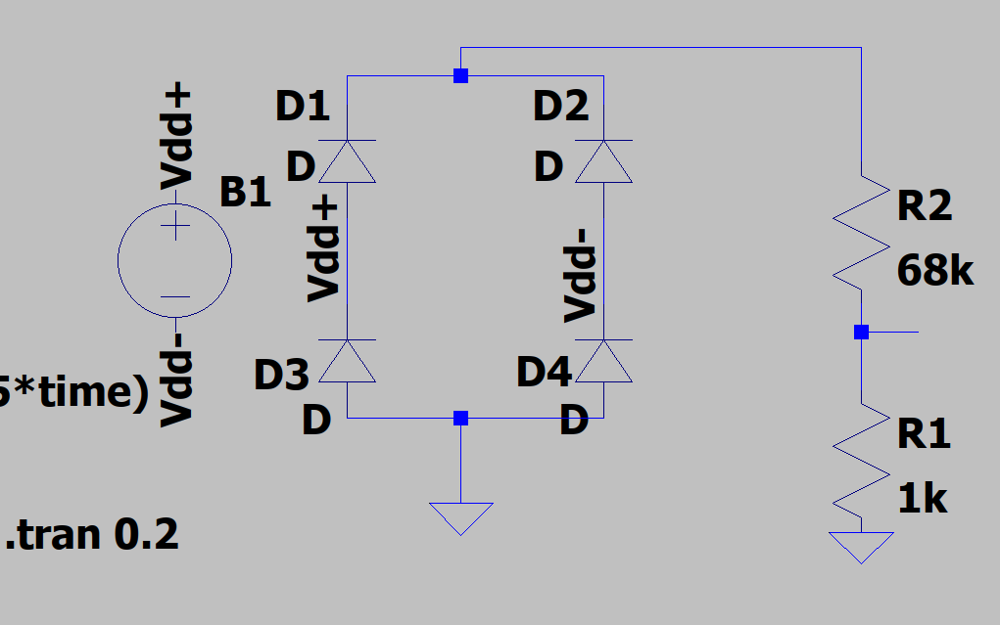
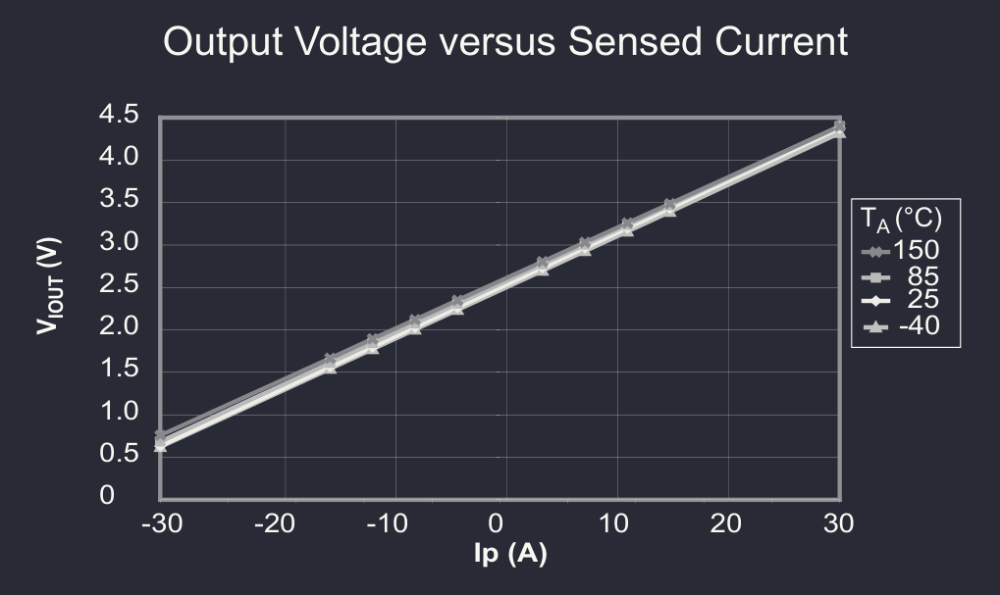

# ESP32-WATTIMETER

ESP32 (ESP-IDF) project for a true-RMS AC wattmeter: an ACS712 Hall-effect sensor measures current and a rectifier + resistive divider measures mains voltage, both sampled by the ESP32 ADC.

## Project goal

The design goal is to compute true-RMS voltage, current and power and show them on a web page and on a 0.96" OLED display. The math behind it is described [below](#math) and in `wattimeter.ipynb`.

## Current firmware state

What the firmware in `wattimeter/` does today:

- Initializes ADC1 (one-shot driver, 12 dB attenuation) through the vendored [`esp32_drivers`](https://github.com/Gedankenn/esp32_drivers) ADC module.
- Reads the **ACS712 current sensor on ADC1 channel 0 (GPIO 36)** and converts it to amperes (100 mV/A sensitivity, 2.5 V zero-current offset, 0.66 divider gain).
- Reads the **voltage sensor on ADC1 channel 6 (GPIO 34)** (1 kΩ / 68 kΩ divider, gain 0.0147).
- Prints raw ADC values and converted readings to the serial console every 2.5 s.

RMS calculation, power calculation, the web page and the OLED display are **not implemented yet**.

## Hardware
- ESP32 DevKitC
- ACS712 current sensor
- 0.96" OLED display (planned)
- 10MΩ  Resistor
- Hi-Link HLK-PM01 AC-DC converter 5V

## Repository layout

```
esp32_wattimeter/
├── wattimeter/                  # ESP-IDF project (target esp32, sdkconfig from ESP-IDF 5.4.0)
│   ├── CMakeLists.txt
│   └── main/
│       ├── wattimeter.c
│       ├── application/         # app.c (main loop), acs712.c (current), voltage.c (voltage)
│       └── esp32_drivers/       # copy of the esp32_drivers ADC/PWM wrappers
├── wattimeter.ipynb             # design notebook: ACS712 scaling, divider calculations, simulated signals
├── ltspice_simulations/         # LTspice model of the rectifier + divider voltage sensor
├── voltage_sensor.png           # voltage-sensor circuit
└── current_sensor.png           # ACS712 datasheet excerpt
```

## Build and flash

```bash
cd wattimeter
. $IDF_PATH/export.sh
idf.py set-target esp32
idf.py build
idf.py -p /dev/ttyUSB0 flash monitor   # replace with your serial port
```

The project builds with ESP-IDF 5.4.

## Software
- ESP-IDF
- Python 3 + Jupyter (`matplotlib`, `mplcyberpunk`) for the analysis notebook

## Math
### Voltage
The Voltage is measured by the ADC of the ESP32. The ADC has a resolution of 12 bits and a reference voltage of 3.3V. The voltage is calculated by the formula:

```
V = (ADC * 3.3) / 4095

```

The Voltage is retified and then attenuated by a voltage divider. The voltage divider is made by a 68kΩ resistor and a 1kΩ resistor. The voltage is calculated by the formula:

```
Vout = Vin * (R2 / (R1 + R2))
```
where: R1 = 68kΩ, R2 = 1kΩ

To get the real voltage value we need to multiply the voltage by the voltage divider factor. The voltage divider factor is given by the formula:

```
V = Vout * 69
```
The circuit:


The Voltage is given by the integral of the voltage over a period of time. The integral of the voltage is given by the formula:

$$
V = \frac{V1 + V2 + V3 + ... + Vn}{n}
$$

The True RMS Voltage is given by the square root of the average of the square of the voltage over a period of time. The True RMS Voltage is given by the formula:

$$
Vrms = \sqrt{\frac{V1^2 + V2^2 + V3^2 + ... + Vn^2}{n}}
$$

So the True RMS Voltage is given by the square root of the average of the square of the voltage over a period of time. The True RMS Voltage is given by the formula:
```
Vrms = sqrt((V1^2 + V2^2 + V3^2 + ... + Vn^2) / n)
```


### Current
The datasheet for the current Sensor ACS712:


from the datasheet we can see that 0A is at 2.5V. The sensitivity is 100mV/A. The current is calculated by the formula:

The Current is measured by the ACS712 current sensor. The ACS712 has a sensitivity of 100mV/A. The current is calculated by the formula:
```
I = (((ADC * 3.3) / 4095) -2.5) / 0.1
```

In the firmware (`acs712.c`) the ACS712 output first goes through a divider with gain 0.66 (to bring 0–5 V into the ESP32 ADC range), so the code computes:
```
I = ((((ADC * 3.3) / 4095) / 0.66) - 2.5) / 0.1
```

The Current is given by the integral of the current over a period of time. The integral of the current is given by the formula:

$$
I = \frac{I1 + I2 + I3 + ... + In}{n}
$$

The True RMS Current is given by the square root of the average of the square of the current over a period of time. The True RMS Current is given by the formula:

$$
Irms = \sqrt{\frac{I1^2 + I2^2 + I3^2 + ... + In^2}{n}}
$$

So the True RMS Current is given by the square root of the average of the square of the current over a period of time. The True RMS Current is given by the formula:
```
Irms = sqrt((I1^2 + I2^2 + I3^2 + ... + In^2) / n)
```
